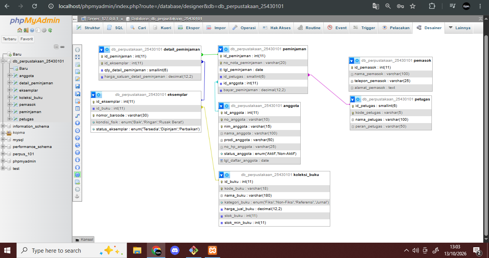

# Laporan Praktikum Basis Data - Pertemuan 03

**Nama** : Mahasiswa Basis Data  
**NPM** : 25430101  
**Kelas** : D  
**Tanggal** : 13 Oktober 2026  
**Dosen Pengampu** : Dedi Irawan, S.Kom., M.Kom.  

---

## 1. Tujuan Praktikum
Setelah menyelesaikan Modul 3, mahasiswa diharapkan mampu:
1. Mengidentifikasi entitas, atribut, dan kunci (kunci primer/PK serta kunci tamu/FK) dari dokumen kebutuhan data.
2. Menentukan relasi antar-entitas beserta kardinalitas dan partisipasinya berlandaskan aturan bisnis organisasi.
3. Memecah relasi banyak-ke-banyak (*many-to-many*) menjadi entitas asosiatif yang memiliki atribut transaksi mandiri.
4. Menggambar ERD notasi *Crow's Foot* dan memvalidasi keterelusurannya terhadap Kebutuhan Informasi (KI).

---

## 2. Ringkasan Dasar Teori
Perancangan konseptual basis data diwujudkan melalui **Entity-Relationship Diagram (ERD)**. ERD memetakan komponen utama basis data:
* **Entitas**: Objek atau kejadian yang datanya disimpan.
* **Atribut**: Karakteristik atau properti dari suatu entitas.
* **Relasi**: Hubungan logis antarentitas dengan membaca kata kerja proses bisnis.

Notasi **Crow's Foot** menggambarkan kardinalitas (maksimum) dan partisipasi (minimum):
* `||` (Tepat satu)
* `O|` (Nol atau satu / opsional)
* `|<` (Satu atau banyak / wajib)
* `O<` (Nol atau banyak)

Relasi *many-to-many* ($M:N$) tidak dapat diimplementasikan langsung dalam skema relasional, sehingga harus diurai menjadi dua relasi $1:N$ melalui **entitas asosiatif** yang menampung atribut gabungan.

---

## 3. Pembahasan Titik Analisis Modul 3

### 3.1 Titik Analisis 1: Kunci Primer Koperasi (`id_anggota` vs `nim_anggota`)
**Pertanyaan:**  
`no_anggota` dan `nim_anggota` sama-sama unik. Mengapa buku ini tetap memakai `id_anggota` sebagai kunci primer? Sebutkan satu risiko jika NIM dijadikan kunci primer.

**Jawaban:**  
`id_anggota` digunakan sebagai kunci primer buatan (*surrogate key*) bertipe numerik auto-increment untuk efisiensi penyimpanan indeks serta konsistensi referensial relasi antar-tabel.  
*Risiko jika `nim_anggota` dijadikan kunci primer*: NIM merupakan kunci alami (*natural key*) dari pihak eksternal (kampus). Jika terjadi perubahan format NIM, koreksi digit mahasiswa, atau anggota umum non-mahasiswa yang tidak memiliki NIM mendaftar, maka seluruh kunci tamu (*Foreign Key*) pada tabel transaksi turunan akan ikut rusak (*cascading update*) dan menimbulkan kerentanan integritas data.

---

### 3.2 Titik Analisis 2: Kardinalitas Penjualan terhadap Detail Penjualan
**Pertanyaan:**  
Sisi penjualan terhadap `detail_penjualan` bernilai *satu atau banyak* (1..N), bukan *nol atau banyak*. Aturan bisnis mana yang memaksanya? Apakah aturan "minimal satu" ini dapat dijaga oleh struktur tabel saja?

**Jawaban:**  
Aturan bisnis yang memaksanya adalah **AB-01** (*"Setiap nota memiliki nomor unik dan minimal satu baris barang"*).  
Aturan "minimal satu" (*mandatory participation*) ini **tidak bisa dijaga oleh struktur DDL tabel saja** karena pada saat perintah SQL `INSERT INTO penjualan` dijalankan, baris `detail_penjualan` belum dibuat (masalah *chicken-and-egg constraint*). Pembatasan ini dijaga melalui mekanisme **transaksi basis data** (*database transaction*) atau *application logic* / *trigger*.

---

### 3.3 Titik Analisis 3: Identifikasi Petugas Penerima Barang
**Pertanyaan:**  
Ketua ingin mengetahui "petugas gudang mana yang menerima barang dari pemasok". Apakah ERD saat ini dapat menjawabnya? Jika belum, relasi apa yang perlu ditambahkan?

**Jawaban:**  
Pada ERD awal, tabel `pembelian` hanya terhubung ke `pemasok`. Untuk menjawab kebutuhan ini, perlu ditambahkan relasi baru antara `petugas` dan `pembelian` dengan kardinalitas **"Petugas mencatat Pembelian"** (1 Petugas melayani 0..N Pembelian). Kunci tamu `id_petugas` wajib ditambahkan pada entitas `pembelian` dan aturan bisnis baru dicatat sebagai: *"Setiap penerimaan barang dari pemasok wajib dicatat oleh tepat satu petugas gudang yang bertugas"*.

---

## 4. Analisis ERD Proyek Mandiri (Perpustakaan Cendekia Mandiri - P=2)

### 4.1 Tabel Relasi dan Kardinalitas

| Relasi | Sisi Kiri | Sisi Kanan | Aturan Bisnis Acuan |
| :--- | :--- | :--- | :--- |
| **Petugas melayani Peminjaman** | Tepat satu petugas (`1`) | Nol atau banyak peminjaman (`0..N`) | Operasional meja sirkulasi |
| **Anggota melakukan Peminjaman** | Nol atau satu anggota (`0..1`) | Nol atau banyak peminjaman (`0..N`) | Peminjaman khusus anggota aktif |
| **Peminjaman berisi Detail_Peminjaman** | Tepat satu peminjaman (`1`) | Satu atau banyak detail (`1..N`) | AB-02 (Maksimal 4 buku, $P+2=4$) |
| **Eksemplar tercantum di Detail_Peminjaman** | Tepat satu eksemplar (`1`) | Nol atau banyak detail (`0..N`) | AB-03 & AB-04 (Status eksemplar) |
| **Koleksi_Buku mencakup Eksemplar** | Tepat satu judul buku (`1`) | Satu atau banyak eksemplar (`1..N`) | Katalog riset & inventaris fisik |

---

### 4.2 Penelusuran Kebutuhan Informasi (KI) ke Jalur ERD

| Kode KI | Kebutuhan Informasi | Jalur Penelusuran Entitas di ERD | Status Keterelusuran |
| :---: | :--- | :--- | :---: |
| **KI-01** | Rekapitulasi jumlah sirkulasi peminjaman harian/bulanan | `Peminjaman` $\rightarrow$ `Detail_Peminjaman` | Valid |
| **KI-02** | Laporan judul buku terpopuler paling sering dipinjam | `Koleksi_Buku` $\rightarrow$ `Eksemplar` $\rightarrow$ `Detail_Peminjaman` | Valid |
| **KI-03** | Laporan anggota dengan peminjaman melewati batas tempo | `Anggota` $\rightarrow$ `Peminjaman` $\rightarrow$ `Detail_Peminjaman` | Valid |
| **KI-04** | Rekapitulasi penerimaan denda keterlambatan | `Peminjaman` $\rightarrow$ `Detail_Peminjaman` (Atribut `denda_terbayar`) | Valid |
| **KI-05** | Laporan ketersediaan eksemplar fisik buku di rak | `Koleksi_Buku` $\rightarrow$ `Eksemplar` (Atribut `status_eksemplar`) | Valid |

---

## 5. Catatan Tinjauan Klien (*Client Review*)

Sesuai instruksi modul, rancangan ERD telah ditinjau oleh rekan sejawat/klien dengan hasil sebagai berikut:

1. **Umpan Balik 1**: *"Apakah denda dihitung per transaksi atau per buku yang terlambat?"*  
   * **Keputusan**: Diterima. Denda dihitung per buku per hari keterlambatan (Rp2.000/hari/buku sesuai parameter $P=2$, AB-06) dan disimpan pada entitas `Detail_Peminjaman`.
2. **Umpan Balik 2**: *"Bagaimana jika anggota mengembalikan 2 buku lebih awal dan 2 buku tersisa terlambat?"*  
   * **Keputusan**: Diterima. Kolom `tgl_kembali_riil` ditempatkan pada entitas `Detail_Peminjaman` (bukan di header `Peminjaman`) sehingga setiap item buku memiliki riwayat pengembalian independen.

---

## 6. Bukti Tangkapan Layar Diagram ERD
*(Tangkapan layar hasil rancangan ERD pada draw.io)*

1. **Diagram ERD Kopma Sejahtera:**  
   

2. **Diagram ERD Perpustakaan Cendekia Mandiri (P=2):**  
   
